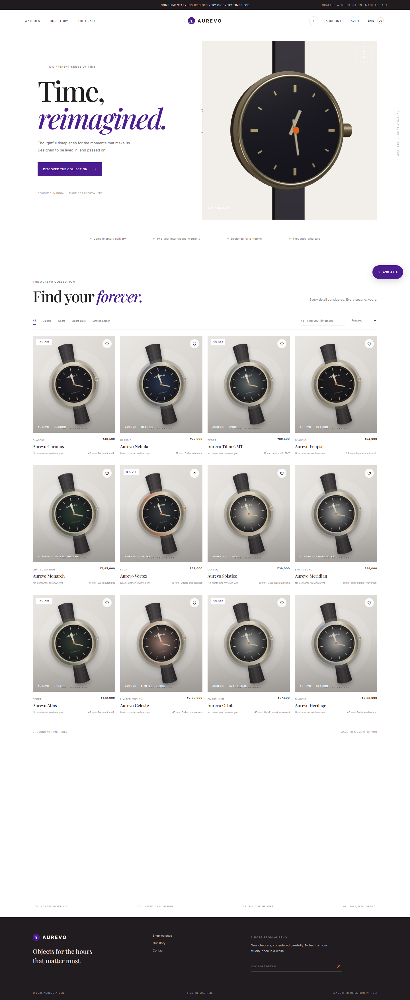
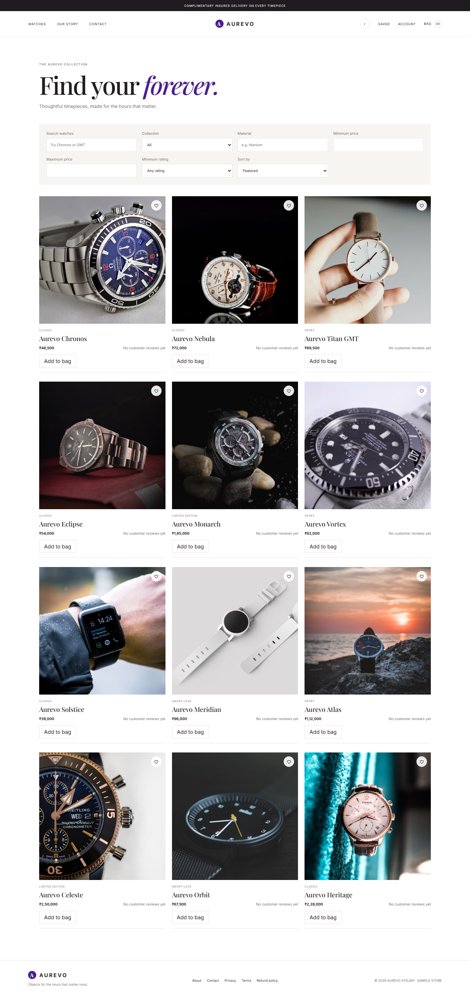
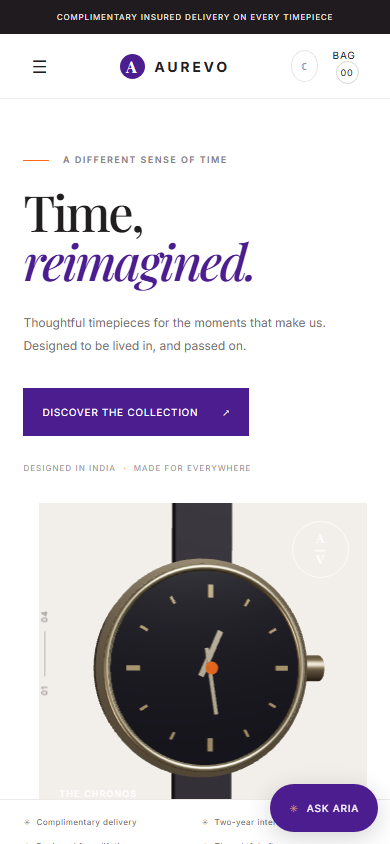

# AUREVO — Time, Reimagined.

[](https://anji0522.github.io/aurevo-watch-store/)

**Live demo:** https://anji0522.github.io/aurevo-watch-store/

**GitHub repository:** [Anji0522/aurevo-watch-store](https://github.com/Anji0522/aurevo-watch-store)

AUREVO is a JavaScript MERN storefront for a sample collection of watches. The storefront can be browsed in read-only demo mode; accounts, orders, reviews, and checkout require a running API and configured services.

## Features

- Browse and filter a 12-watch sample catalog, with product details and a procedural 3D watch viewer.
- Save products to a wishlist and add products to a persistent shopping bag.
- Sign-up, sign-in, profile, order history, and review flows when the API and MongoDB are configured.
- Razorpay test-mode checkout with server-side payment verification and PDF invoices.
- Streaming Aria assistant with a friendly fallback when provider credentials are absent.

## Tech stack

- React 18, React Router, Zustand, and Vite
- Node.js, Express, MongoDB, and Mongoose
- Three.js, React Three Fiber, and Drei
- Vitest, Testing Library, Node's test runner, and Playwright

## Screenshots / demo

The screenshots below are local captures of the storefront; they are not screenshots of the live deployment.







## Prerequisites, installation, and local setup

Install Node.js 20+ and MongoDB Community Server or obtain a MongoDB Atlas connection string. Then run:

```bash
npm install
```

Copy `.env.example` to `.env` and set the values needed for your local setup. Start the frontend and API together:

```bash
npm run dev
```

The Vite frontend is available at [http://localhost:5173](http://localhost:5173) and the API at `http://localhost:5000`. The frontend proxies `/api` requests to the local API. `npm run client:dev` starts only Vite; API-backed functionality then requires a separately running API. The sample catalog is available without MongoDB, but account and order functionality require a database.

To insert or update the sample watches and demo reviews, run `npm run seed`.

## Environment variables

Variable names from `.env.example` (no values are included here):

`PORT`, `MONGODB_URI`, `CLIENT_URL`, `VITE_API_URL`, `JWT_SECRET`, `RAZORPAY_KEY_ID`, `RAZORPAY_KEY_SECRET`, `RAZORPAY_WEBHOOK_SECRET`, `ANTHROPIC_API_KEY`, `ANTHROPIC_MODEL`, `EMAIL_HOST`, `EMAIL_PORT`, `EMAIL_SECURE`, `EMAIL_USER`, `EMAIL_PASSWORD`, `EMAIL_FROM`.

Keep secrets server-side and out of `VITE_` variables. Only `VITE_API_URL` is intended as public client configuration.

## Available scripts

| Command                | Purpose                                             |
| ---------------------- | --------------------------------------------------- |
| `npm run dev`          | Start the frontend and API together                 |
| `npm run client:dev`   | Start only the Vite frontend on port 5173           |
| `npm run server:dev`   | Start the API with Node watch mode                  |
| `npm start`            | Start the API                                       |
| `npm run seed`         | Seed the sample catalog and reviews                 |
| `npm run build`        | Build the frontend for production                   |
| `npm run deploy`       | Build and publish `dist` to the GitHub Pages branch |
| `npm test`             | Run server and client tests                         |
| `npm run test:server`  | Run server/API tests                                |
| `npm run test:client`  | Run frontend tests                                  |
| `npm run test:e2e`     | Run mocked Playwright journeys                      |
| `npm run lint`         | Lint application and test code                      |
| `npm run format:check` | Check formatting                                    |

## Project structure

```text
client/
  index.html
  public/                Favicon, logo, and placeholder image
  src/
    api/                 API and CSRF client
    components/          Store shell, assistant, and 3D watch viewer
    pages/               Storefront routes and page tests
    store/               Persistent bag and wishlist state
    App.jsx              Home page and route setup
server/
  data/                  Sample watches and demo reviews
  middleware/            Authentication, CSRF, and error handlers
  models/                MongoDB/Mongoose models
  routes/                Store, account, order, review, payment, and AI APIs
  services/              Payment, email, and assistant integrations
  scripts/               Catalog seed script
  index.js               Express API
tests/                   Server and API tests
e2e/                     Mocked Playwright user journeys
screenshots/             Desktop and mobile screenshots
dist/                    Generated frontend build (not committed)
```

## Deployment notes

The live frontend is deployed on GitHub Pages. Vite's `base` is configured for `/aurevo-watch-store/`; `npm run deploy` builds the site, adds an SPA fallback page, and publishes `dist`.

GitHub Pages hosts static files only. API-dependent features require a separately deployed Express API and a MongoDB connection. For a separate frontend/API deployment, configure `VITE_API_URL` to the API's public origin and set `CLIENT_URL` to the exact frontend origin on the API. The repository also contains `render.yaml` for the API and `vercel.json` for a Vite deployment. No live database, payment, email, or AI provider credentials are included.

## Troubleshooting

**“The request could not be completed.”** This is the API client's generic message when an API request fails and the response does not contain a usable JSON error. The underlying cause is usually that the request reached a static frontend host, or that the Express API is not running/reachable; the catalog and account endpoints are served by Express, not Vite or GitHub Pages. Run `npm run dev` locally to start both services, or deploy the API and set `VITE_API_URL` and `CLIENT_URL` for the separate hosts. The home page also displays a retry action when its catalog request fails.

**A direct route refresh returns a not-found page.** Deploy with `npm run deploy`; it publishes `dist/index.html` as `404.html` so GitHub Pages can load the client-side routes.

## License

No license file is included. Obtain permission from the copyright holder before reusing or distributing this project.
